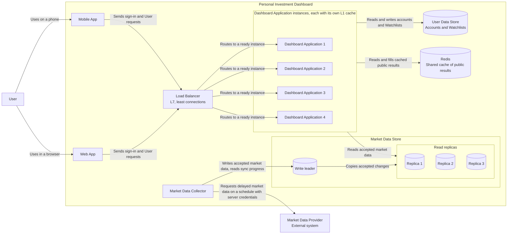
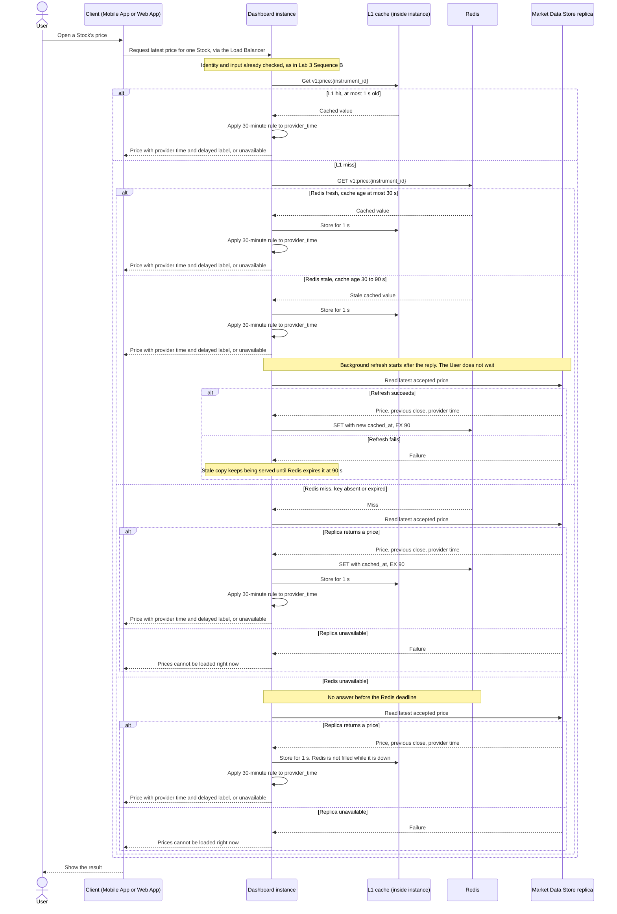
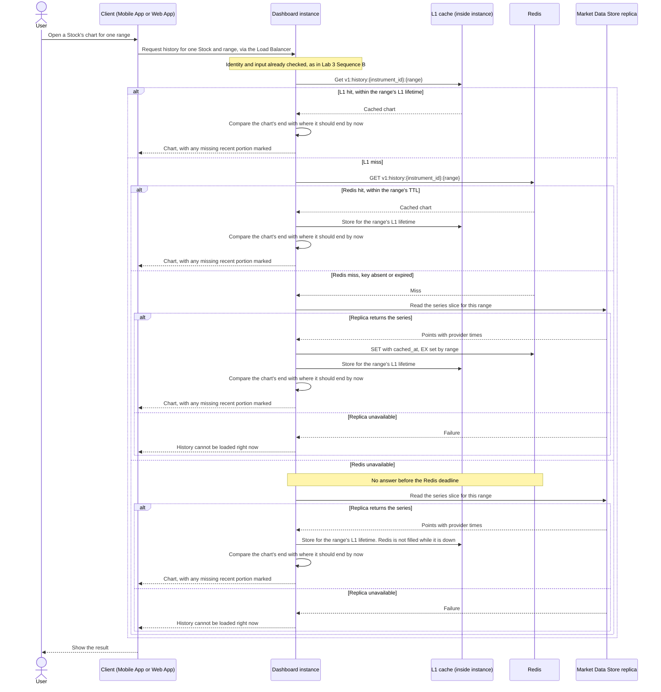

# Lab 4: Scale the Dashboard Read Path — Working Draft

## Inputs carried forward

| Input | From | Value |
| ----- | ---- | ----- |
| Stock price load at 3,000 Users | Lab 2 | 600 RPS |
| Stock price latency | Lab 2 | p50 ≤ 300 ms, p95 ≤ 1 s, unavailable after 2 s (client-observed) |
| Freshness rule | Lab 2 | Shown with provider time and delayed label up to 30 min old by provider time; unavailable beyond that or if never received; never zero |
| Sync interval | Lab 2 / Lab 3 | Collector writes accepted prices every 5 min during market hours (Xetra 09:00–17:30 local) |
| Market data writer | Lab 3 | Only the Market Data Collector writes the Market Data Store |
| Market data reader | Lab 3 | MarketDataReader inside the Dashboard Application; User reads never call the provider |
| Private data | Lab 3 | Watchlists live in the User Data Store; forbidden ≠ empty ≠ fetch failure |

## Given for this lab

- 600 Stock price RPS, with a 20% capacity buffer; target preserved after one Dashboard instance stops.
- One Dashboard instance safely handles 250 Stock price RPS.
- Market Data Store: one node serves at most 400 public read RPS; each read replica serves 400. The write leader is reserved for writes and latest-value reads, and does not count toward public-read capacity.
- Local memory (L1) can lose any entry at any time. Redis can be empty or unavailable, including just before market open. No cache hit rate may be assumed when sizing.

## Changes to earlier decisions

| Earlier decision | Change in Lab 4 | Reason |
| ---------------- | --------------- | ------ |
| Lab 3: no API Gateway, clients call the single Dashboard Application directly | A **load balancer** is added in front of the Dashboard instances | With four instances, something must select a ready one for each request. Lab 3's reason for skipping a gateway (one backend, nothing to route between) no longer holds |
| Lab 3: one Dashboard Application instance | **Four ready instances** | One instance handles 250 price RPS; the 720 RPS buffered target must survive one instance loss |
| Lab 3: Market Data Store drawn as one store | **One write leader + three read replicas** | One node serves 400 public-read RPS; the target is 720 |
| Lab 3: sign-in mechanism unspecified | **Signed tokens**, with a signing key shared by all instances | Any instance must verify identity; no state may live in one instance's memory |
| Lab 2 Rule A: a price over 30 minutes old is unavailable | **Market-hours aware.** Outside market hours, the last session's close is current and is shown with a "closing price" label. During the first 30 minutes after the 09:00 open, the previous close still counts as current. Otherwise the 30-minute rule is unchanged | As written, Rule A made every price unavailable every night and weekend, since the latest price is then the previous close. The History freshness rule already handled this; the price rule now matches it |
| Lab 3: no cache, deferred until measured | **Redis** added as a new shared container, plus an **L1** cache inside each instance | Lab 4 supplies the measurements Lab 3 was waiting for. Capacity is still sized with no cache hit rate, so the caches reduce repeated work and latency, not instance or replica counts *(cache use cases detailed in Section 3)* |

---

## 1. Scale the service and route requests

### Instance calculation

```text
buffered target = 600 x 1.20 = 720 Stock price RPS

instances for normal load = ceil(720 / 250) = ceil(2.88) = 3   ->  3 x 250 = 750 RPS
with 3 instances and one loss:  2 x 250 = 500 RPS   (too little)
with 4 instances and one loss:  3 x 250 = 750 RPS   (meets 720)

starting minimum = 4 ready Dashboard instances  (1,000 RPS with all four ready)
```

The 250 RPS capacity is measured in **Stock price** RPS. The Lab 2 market-open target of 1,030 RPS covers all six reads combined; Stock price itself stays near 600 RPS during market open, since the burst lands on Overview and Watchlist. The other reads also use instance capacity. That is one more reason to keep the spare instance, but the total needs its own load test before this count is trusted for all traffic.

### Read-replica calculation

```text
public-read target = 720 RPS; each read replica serves 400 RPS
the write leader is not counted toward public-read capacity

replicas for normal load = ceil(720 / 400) = 2   ->  800 RPS
with 2 replicas and one loss:  1 x 400 = 400 RPS   (too little)
with 3 replicas and one loss:  2 x 400 = 800 RPS   (meets 720)

chosen = 1 write leader + 3 read replicas  (1,200 public-read RPS with all three ready)
```

The lab requires surviving the loss of one Dashboard instance, not of one replica. A third replica is added anyway. With only two, losing one would halve public-read capacity during market hours, and every price read the remaining replica could not serve would count against the 2.55 h monthly market-hours downtime budget from Lab 2. With three, losing a replica is invisible to Users: the remaining two hold the same accepted prices and still cover the target.

Sizing assumes **no cache hit rate**, as the lab requires. Caching in Section 3 reduces repeated work and latency; it does not reduce the instance or replica count.

### What runs on the write leader

- **The Market Data Collector's writes:** every 5 minutes, latest prices for all 4,106 instruments plus intraday history points, and the daily history and metadata batches. The Collector writes **only** to the leader; the leader copies accepted changes to the replicas.
- **The Collector's sync-progress reads,** since those need the latest value.

Watchlist writes do not touch this store. They go to the User Data Store (Lab 3).

**Sharding is not needed.** Sharding splits data across nodes when one node cannot hold the data or absorb the writes. The retained dataset is ≈248 MiB (Lab 2), and writes arrive as one batch every 5 minutes. Neither pressure exists.

### Leader loss

If the write leader stops, a read replica is promoted to leader, as a separate failover decision. Reads continue from the remaining replicas, but the Collector cannot save new data in the meantime, so stored prices age. Users see the last accepted prices with their delayed label until those pass 30 minutes by provider time, then unavailable. The 30-minute freshness rule therefore sets the practical deadline for failover. With asynchronous replication, the promoted replica may lack the most recent batch. That is acceptable: the next 5-minute sync rewrites it, and the Lab 3 newer-only write rule makes the rewrite safe.

**Replication lag needs no extra rule.** Every stored price carries its provider time, so a read from a slightly behind replica computes a correct, older age. The 30-minute rule then decides the result, exactly as it would on the leader.

### Load-balancer choice

**Layer: L7.** Both clients send HTTPS requests, and an L7 balancer chooses an instance for each HTTP request rather than once per connection. An L4 balancer chooses once, when a connection opens, and every later request on that connection goes to the same instance. Since mobile clients reuse one connection for many requests, L4 would balance connections rather than requests. Health checks: L4 balancers can test whether an instance's port accepts connections, but a process can accept connections while being unable to serve. An HTTP readiness check (such as `GET /ready`) asks the application itself whether it can serve, for example whether it can reach its stores, so a starting or unhealthy instance receives no new requests. Cost of L7: the balancer must terminate TLS (decrypt the HTTPS request) to read it, so it does the decryption work and must protect the certificate's private key.

**Method: least connections, one pool of instances.**

- **Why it fits:** Stock price requests have similar cost, but the same instances also serve History reads, which Lab 2 found far more expensive (a 5Y read returns ≈1,825 points). An expensive request holds its connection longer, so least connections steers new requests away from busy instances without any custom signal. Round robin would keep sending them equal shares regardless.
- **Main limit:** connection count is only a stand-in for real work. Two open connections do not necessarily cost the same CPU, and idle long-lived connections can make a quiet instance look busy.
- **Not chosen: hash by client IP.** No request depends on reaching the same instance, since no required state lives in one instance's memory. Mobile Users also change IP often, and many Users can share one IP.

**Alternative kept in reserve: two pools.** L7 could route Stock price requests to one group of instances and every other read to another, isolating price p95 from expensive History reads. Both groups would run the same Dashboard Application, so this is one C4 container with two instance groups, not a new container. It is deferred until measurement shows History reads still raise price p95 under least connections.

**Rejected: per-instance request queues.** A queued request spends its latency budget while it waits, and price reads must finish within 1 s at p95 and are unavailable after 2 s. The queue would also live in one instance's memory and be lost with it. An overloaded instance should reject quickly so the request can be retried and routed elsewhere.

### State that must survive an instance loss

**Sign-in uses signed tokens.** Any instance verifies a token's signature and expiry without a store lookup, which keeps identity checks off the store on every request. Accepted cost: a token cannot be revoked before it expires, so a stolen device stays signed in until then. This is acceptable for a view-only v1, where a stolen token exposes a Watchlist, not money. Tokens use a short expiry to limit that window. The apps renew the short-lived token in the background with a longer-lived refresh credential, so Users stay signed in without being asked to sign in again each time the short token expires. **Revisit condition:** if trading is added, switch to revocable sessions in the User Data Store.

| State | Where it lives | If one Dashboard instance stops |
| ----- | -------------- | ------------------------------- |
| Watchlists | User Data Store | Unaffected; any instance reads the confirmed value |
| User accounts | User Data Store | Unaffected |
| Token signing key | Shared configuration, identical on every instance | Any instance still verifies tokens issued by another |
| Accepted market data and sync progress | Market Data Store | Unaffected |
| L1 copies of public results (e.g. Stock price) | That instance's memory | Lost; the next request checks Redis or the store |
| Parsed fields of the current request | That instance's memory | The in-flight request may fail; a retry is parsed again elsewhere |
| Identity verified for the current request | That instance's memory | The next request is verified again by whichever instance receives it |

**Watchlists are never cached in L1.** Rule B (Lab 2) requires the same User's next read after a confirmed change to show it. With four instances and least connections, a change made through instance 2 could be followed by a read served from instance 3's older L1 copy, which would hide the change and look like a failed add. Keeping each copy correct would require every instance to discard its copy on any change. It would also save little: each Watchlist is read only by its owner (≈30 RPS in total), so copies would rarely be reused. Watchlist reads therefore always go to the User Data Store.

---

## 2. Scale the Market Data Store — updated Container view



Outgoing arrows from the four Dashboard instances are drawn once, from the group, for readability. Every instance has the same relationships.

| Container | Responsibility | Change from Lab 3 |
| --------- | -------------- | ----------------- |
| Mobile App, Web App | Provide the User's interfaces | Now send requests to the Load Balancer instead of directly to the Dashboard Application |
| Load Balancer | Sends each request to a ready Dashboard instance, by least connections | **New** |
| Dashboard Application (×4) | Serves all User requests | Four ready instances instead of one; each holds its own L1 cache |
| Redis | Holds a shared cache of public results, used by all four instances | **New** |
| Market Data Collector | Keeps accepted market data current by scheduled sync | Unchanged: one process, triggered by schedule only, never by a User request |
| User Data Store | Retains accounts and Watchlists | Unchanged |
| Market Data Store | Retains accepted market data and sync progress | Opened into one write leader and three read replicas |

### Notes

**Why Redis is a container and L1 is not.** Redis runs as its own process, can fail while every Dashboard instance keeps running, and is shared by all four instances, so a value one instance fetches and stores is available to the others. Those are the marks of a separately running part, so it gets its own box. L1 is the opposite: it lives inside each instance's process, is private to that instance, and disappears with it. It is part of the Dashboard Application, not a container.

**Lookup order: L1 → Redis → Market Data Store replicas.** An absent L1 entry is normal, not a fault, since L1 may lose any entry at any time. Two Redis cases are distinct:
- Redis is **up but lacks the key**: the instance reads a replica, then fills Redis and L1.
- Redis is **unavailable**: the instance reads a replica and fills **only L1**. Redis cannot be updated while it is down.

**Which node serves what.**
- Public market-data reads from all four instances are spread across the three ready read replicas, and never sent to the leader.
- The write leader receives only the Collector's writes and its sync-progress reads, which need the latest value.
- The leader copies accepted changes to the replicas.

**Unchanged from Lab 3:** the Collector is the only writer of market data, User reads never call the provider, and the Collector alone holds provider credentials.

---

## 3. Cache two public reads

### Use case 1: Stock price

**Why cache it:** Stock price is ~600 of 792 steady RPS (Lab 2), and the same popular instruments are requested by many Users. The underlying value changes at most once every 5 minutes, when the Collector writes a new sync. Most reads therefore repeat work that has already been done.

**Cache contract**

| Field | Value |
| ----- | ----- |
| Key | `v1:price:{instrument_id}` |
| Value | JSON: `instrument_id`, `price`, `previous_close`, `provider_time`, `cached_at` |
| Source | Market Data Store read replicas, never the leader or the provider |
| L1 lifetime | 1 second |
| Redis policy | Stale-while-revalidate: fresh up to 30 s of cache age, stale-but-servable from 30 s to 90 s, Redis expiry (`EX`) 90 s |
| Private data | None. The key and value hold only public market data; no User id appears in either |

**Key format.**
- `instrument_id` is the stable internal identifier from the Lab 2 reference data. A ticker is avoided because it is a display name: it can change when a company renames, and the same letters can belong to different instruments.
- The `v1:` prefix is the value-format version. If the value's fields change later, new code uses `v2:` keys and never misreads an old-format value. Old `v1:` entries simply expire within 90 s.

**Two clocks, kept apart.**
- `provider_time` answers *is the price fresh?* It drives the 30-minute rule and is shown to the User.
- `cached_at` answers *is this cache copy due for a refresh?* It drives the 30 s / 90 s cache rule and is never shown as the price's age.

**Why a fresh cache entry does not prove a fresh price.** Suppose the last successful sync was at 09:40 and the provider then went down. The store keeps holding the 09:40 prices. Each time a cache entry passes its stale limit, an instance re-reads the store and writes a brand-new entry with a new `cached_at`. At 10:15 the Redis entry may be seconds old, yet its price is 35 minutes old by provider time. A Redis TTL only says how long ago the *copy* was made, not how old the *data* is. So **every hit, from L1 or Redis, applies the 30-minute rule on `provider_time` before anything is shown.** Past 30 minutes, the result is unavailable, however recently it was cached.

**Why stale-while-revalidate rather than a plain TTL.** The most popular instruments are requested many times per second. With a plain TTL, the moment a hot key expired, every request in the next instant would miss together and reach the replicas at once, and each of those Users would wait for the slower source read. With stale-while-revalidate, the recent entry keeps being served instantly while a background refresh fetches the new value. Each instance runs at most one refresh per key at a time, so at most four refreshes reach the replicas instead of a crowd, and no User waits. Reducing this to exactly one across all instances would need a lock shared between instances, which is not worth the complexity at this scale. That protects the p95 ≤ 1 s target.

**No "refreshing" label needed.** The User always sees the price with its true `provider_time` and the delayed label. A stale cache copy still carries the real provider time, so the User is never misled about the price's age.

**Worst-case age shown to a User**

```text
provider delay + sync interval + stale limit + L1 lifetime
=      15      +       5       +     1.5     +   1/60       ≈ 21.5 minutes
margin under the 30-minute limit ≈ 8.5 minutes
```

The margin absorbs a late sync run or replication lag without pushing correct prices into unavailable.

**Price freshness by time of day** (updated from Lab 2 Rule A, see the changes table)

| When | A price is current if | Label shown |
| ---- | --------------------- | ----------- |
| Outside market hours (nights, weekends) | It is the last session's close | "Closing price" with provider time |
| First 30 minutes after the 09:00 open | It is at most 30 minutes old, **or** it is the previous close | "Delayed", or "closing price" while still the previous close |
| Rest of market hours | It is at most 30 minutes old by provider time | "Delayed" with provider time |

Otherwise the price is unavailable. The grace period at the open exists because the first delayed prices of a session cannot exist before about 09:15, and then need a sync to be stored. Without it, yesterday's close would suddenly count as about 15 hours old at 09:16, and every price would show unavailable for a few minutes each morning.

**Behavior by cache age**

| Situation | Result |
| --------- | ------ |
| L1 hit (≤ 1 s) | Check provider time, return |
| Redis fresh (≤ 30 s) | Fill L1, check provider time, return |
| Redis stale (30–90 s) | Return the stale copy after the provider-time check; start a background refresh, at most one per key per instance |
| Background refresh fails | Keep serving the stale copy until 90 s |
| No usable copy (missing, or past 90 s) | Read a replica, fill Redis and L1, check provider time, return |
| Redis unavailable | Read a replica, fill only L1, check provider time, return |
| Replicas unavailable and no usable copy | "Prices cannot be loaded right now", the temporary-failure result from Lab 3 Sequence B |
| Any copy that fails the time-of-day freshness rule below | Price unavailable, whatever its cache age |

**Sequence: Stock price read through L1, Redis, and a replica**



**Starting assumptions**
- The request reached this instance through the Load Balancer, and identity and input were already checked as in Lab 3 Sequence B.
- The Market Data Collector has been syncing on schedule. This read does not depend on whether its latest run succeeded; it only reads accepted data.
- Every path that returns a price applies the 30-minute rule to `provider_time`. Past 30 minutes the result is unavailable, whatever the cache age.
- Background refresh is shown after the reply because a sequence diagram cannot draw two things at once. In practice the reply is sent first and the refresh runs separately, so the User never waits on it.
- A Redis miss and Redis being unavailable differ in one step: a miss fills Redis and L1; while Redis is down, only L1 is filled.


### Use case 2: History

**Why cache it:** History is the most expensive single read. A 5Y chart returns about 1,825 points, and Lab 2 flagged concurrent History reads as a possible cause of raised p95 on *every* read path. The same charts for popular instruments are requested by many Users, and most series change rarely: the daily series gets one new point per day.

**Cache contract**

| Field | Value |
| ----- | ----- |
| Key | `v1:history:{instrument_id}:{range}`, where `range` is one of `1D`, `1W`, `1M`, `6M`, `1Y`, `5Y` |
| Value | JSON: `instrument_id`, `range`, `interval`, `points` (a list of `{provider_time, price}`), `latest_provider_time`, `cached_at` |
| Source | Market Data Store read replicas, never the leader or the provider |
| Redis policy | Plain TTL. History is requested far less than Stock price, so there is no hot-key stampede to protect against, and the simpler policy is enough |
| Private data | None. Public market data only |

The `v1:` prefix and the use of `instrument_id` rather than the ticker follow the same reasoning as Stock price. `range` must be in the key because each range returns a different slice of data; without it, a 1D request could receive a cached 5Y result.

**Lifetimes per range, tied to how often each series gets a new point**

| Range | Points in one chart | Approx. value size | New point arrives | Redis TTL (`EX`) | L1 lifetime |
| ----- | ------------------- | ------------------ | ----------------- | ---------------- | ----------- |
| 1D | 102 (one session of 5-min points) | ≈ 4.5 KB | every 5 min | 90 s | 10 s |
| 1W | 238 (7 days of 15-min points) | ≈ 10 KB | every 15 min | 5 min | 10 s |
| 1M | 60 (30 days at ~2 points/day) | ≈ 2.7 KB | every ~4 h | 2 h | 30 s |
| 6M | 180 daily points | ≈ 8 KB | once per day, after close | 6 h | 30 s |
| 1Y | 365 daily points | ≈ 16 KB | once per day, after close | 6 h | 30 s |
| 5Y | 1,825 daily points | ≈ 80 KB | once per day, after close | 6 h | 30 s |

Point counts are the size of one chart's *window*, not the Lab 2 *retention*. Each intraday series retains two windows and shows one (1D keeps 2 days, 1W keeps 2 weeks, 1M keeps 2 months). The second window is a buffer: at market open, today's session has almost no points, so the 1D chart can show the last full session instead of an almost empty one; and a "last 24 hours" view reaches back into the previous day. Sizes assume roughly 40–50 bytes per point in JSON. A 5Y value is about a thousand times larger than a cached Stock price.

`range` is how much time the chart covers; `interval` is the spacing between its points. In this design each range has exactly one interval, so `interval` could be derived from `range`. It is included so the value describes itself, which is what the freshness check uses to work out where the chart's end should be.

**1D worst-case age of the latest point:** 15 (provider delay) + 5 (sync interval) + 1.5 (TTL) + 1/6 (L1) ≈ **21.7 minutes**, the same margin under 30 minutes as Stock price.

**L1 size bound.** Caching every range for every instrument would cost about 120 KB per instrument, or roughly 490 MB per instance for all 4,106. L1 is therefore capped at **50 MB per instance** with least-recently-used eviction: when full, the entry read longest ago is dropped. Popular charts keep being read and stay; rarely used ones fall out on their own. 50 MB holds roughly the full set of ranges for about 410 instruments, around 10% of the supported scope, with no popularity list to maintain.

**Freshness rule for History.** Older points on a chart are not supposed to be current; a point from last March is correct as last March. What can be stale is the *end* of the chart. On every hit, the instance compares `latest_provider_time` with the newest point that ought to exist by now:
- **During market hours (intraday ranges):** the newest point should be at most about 30 minutes behind, by the same rule as Stock price.
- **Outside market hours:** no new intraday points are expected, so an end-point at the 17:30 close is current, not stale.
- **Daily ranges:** the newest point should be the last completed trading session, once the daily sync has had time to store it (about 18:00, after the 17:30 close). At 17:45 on a Tuesday the chart correctly ends at Monday.

If the end is behind, the chart is still shown, with the missing recent portion clearly marked. This follows the Lab 1 Epic 3 rule: show the parts that can be loaded and mark the missing portion. A whole chart is never shown as unavailable just because its newest segment is late.

**Accepted gap: late daily point in the evening.** The daily point is stored after the 17:30 close. A daily-range entry cached shortly before the daily sync can live up to 6 hours beyond it. Example: cached at 17:00, it expires at 23:00. Until then, Users see that chart without the newest day, and the freshness rule marks that day as missing even though it is already stored. This is a false "missing" marker, and it is accepted for v1 because it affects only the newest daily point, outside market hours. **Possible fixes if it matters later:** a 1-hour TTL (about 24 reads per key per day instead of 4), or re-reading the source when a cached chart ends before the most recent daily sync.

**Behavior**

| Situation | Result |
| --------- | ------ |
| L1 hit | Check that the chart's end is current, return |
| L1 miss, Redis hit | Fill L1, check that the chart's end is current, return |
| Both miss | Read a replica, fill Redis and L1, check that the chart's end is current, return |
| Redis unavailable | Read a replica, fill only L1, check that the chart's end is current, return |
| Replicas unavailable and no cached copy | "History cannot be loaded right now", a temporary failure, not an empty chart |
| Chart end behind where it should be | Show the chart and mark the missing recent portion |

**Sequence: History read through L1, Redis, and a replica**



**Starting assumptions**
- The request reached this instance through the Load Balancer, and identity and input were already checked as in Lab 3 Sequence B.
- History uses a plain TTL, so there is no stale-while-revalidate branch: a Redis entry is either within its range's TTL (a hit) or gone (a miss).
- `EX` and the L1 lifetime are taken from the range in the key, per the lifetimes table above.
- On every path that returns a chart, the instance compares the chart's end with where it should end by now (market hours, outside market hours, or daily range). The chart is always shown; if its end is behind, the missing recent portion is marked. Nothing is added to the chart by this check.
- A replica failure with no cached copy gives a temporary failure, never an empty chart.


### Warmup and fallback

**What is warmed: History for the long ranges only.**

| Item | Decision |
| ---- | -------- |
| Instruments | The ~410 most-requested instruments of the previous trading day, about 10% of the 4,106 supported |
| Ranges | 1M, 6M, 1Y, 5Y |
| Key count | 410 × 4 = **1,640 keys**, about 44 MB in Redis |
| When | Starting about 08:00, one hour before the Xetra open, and again after Redis recovers from an outage |
| Rate | Rate-limited, so the 1,640 source reads are spread across the hour rather than sent as a burst |
| Deadline | Warmup stops at 09:00 whether or not it is finished, so it never competes with User traffic |

**Not warmed, and why:**
- **Stock price:** its Redis entry lives only 90 s, so a key warmed early would expire before the open. It does not need warming either: a popular instrument is requested many times per second, so its key refills on the very first request after the open.
- **History 1D and 1W:** their TTLs (90 s and 5 min) would also expire before 09:00. They are cheap to read and fill on demand. Before the first new points of the day arrive, the 1D chart is simply the previous session.
- **The long ranges survive:** 1M (2 h TTL) and the daily ranges (6 h TTL) warmed at 08:00 are still valid at the open.

**If warmup is incomplete.** Keys that were not warmed follow the normal miss path: read a replica, fill Redis and L1. The replicas were sized for the full 720 RPS with **no** cache hits, so an un-warmed key costs only the time of one source read. No result is wrong, and the User sees the same chart, slightly slower.

**Fallback capacity.** When the cache is cold, many requests can miss at once. Each instance limits how many source reads it runs concurrently, so a burst of misses cannot flood the replicas; the exact limit is set by load testing. When that limit is full:
- The request is **rejected immediately** with the temporary-failure result: "cannot be loaded right now, try again." It is not queued, for the reasons given in Section 1.
- This is deliberately **not** "unavailable." In this design, "unavailable" describes the data (too old, or never received). A full limit describes the system at this moment, and the User's correct response differs: retry now, versus wait for new data.
- The client retries after a short wait. The retry may reach a different, less busy instance.

---

## 4. Redis cache path with commands

Redis was run locally (Ubuntu under WSL). Each transcript follows the lab's order: a `GET` that misses, a `SET` with a JSON value and `EX` expiry after reading the durable source, then a `GET` hit and a `TTL` check. Commands were run in the interactive `redis-cli` prompt. The values are sample data for SAP (ISIN `DE0007164600`). In the `GET` output, the backslashes (`\"`) are only how `redis-cli` displays a stored string containing quotes; the stored value is the plain JSON passed to `SET`.

### Transcript 1: Stock price

```text
127.0.0.1:6379> ping
PONG
127.0.0.1:6379> GET v1:price:DE0007164600
(nil)
127.0.0.1:6379> SET v1:price:DE0007164600 '{"instrument_id":"DE0007164600","price":187.42,"previous_close":185.10,"provider_time":"2026-10-21T08:00:00Z","cached_at":"2026-10-21T08:15:03Z"}' EX 90
OK
127.0.0.1:6379> GET v1:price:DE0007164600
"{\"instrument_id\":\"DE0007164600\",\"price\":187.42,\"previous_close\":185.10,\"provider_time\":\"2026-10-21T08:00:00Z\",\"cached_at\":\"2026-10-21T08:15:03Z\"}"
127.0.0.1:6379> TTL v1:price:DE0007164600
(integer) 68
127.0.0.1:6379> TTL v1:price:DE0007164600
(integer) 66
127.0.0.1:6379> TTL v1:price:DE0007164600
(integer) 60
127.0.0.1:6379> TTL v1:price:DE0007164600
(integer) -2
```

Between the miss and the `SET`, the instance reads the latest accepted price from a Market Data Store read replica (Sequence, Use case 1). `EX 90` is the stale limit, so Redis keeps the entry long enough to serve it as stale from 30 s to 90 s. The repeated `TTL` calls show the countdown, and the final `-2` shows that the key no longer exists: Redis deleted it when its 90 seconds ran out, so the next read is a miss and goes to the source.

Stored value:

```json
{
  "instrument_id": "DE0007164600",
  "price": 187.42,
  "previous_close": 185.10,
  "provider_time": "2026-10-21T08:00:00Z",
  "cached_at": "2026-10-21T08:15:03Z"
}
```

`provider_time` is 10:00 Xetra time and `cached_at` is 10:15. The copy is seconds old when written, but the price itself is already 15 minutes old by provider time.

### Transcript 2: History (5Y)

```text
127.0.0.1:6379> GET v1:history:DE0007164600:5Y
(nil)
127.0.0.1:6379> SET v1:history:DE0007164600:5Y '{"instrument_id":"DE0007164600","range":"5Y","interval":"1d","points":[{"provider_time":"2026-10-16T15:30:00Z","price":183.90},{"provider_time":"2026-10-19T15:30:00Z","price":185.10},{"provider_time":"2026-10-20T15:30:00Z","price":186.25}],"latest_provider_time":"2026-10-20T15:30:00Z","cached_at":"2026-10-21T06:05:00Z"}' EX 21600
OK
127.0.0.1:6379> GET v1:history:DE0007164600:5Y
"{\"instrument_id\":\"DE0007164600\",\"range\":\"5Y\",\"interval\":\"1d\",\"points\":[{\"provider_time\":\"2026-10-16T15:30:00Z\",\"price\":183.90},{\"provider_time\":\"2026-10-19T15:30:00Z\",\"price\":185.10},{\"provider_time\":\"2026-10-20T15:30:00Z\",\"price\":186.25}],\"latest_provider_time\":\"2026-10-20T15:30:00Z\",\"cached_at\":\"2026-10-21T06:05:00Z\"}"
127.0.0.1:6379> TTL v1:history:DE0007164600:5Y
(integer) 21583
127.0.0.1:6379> TTL v1:history:DE0007164600:5Y
(integer) 21577
```

Between the miss and the `SET`, the instance reads the daily series slice from a read replica (Sequence, Use case 2). `EX 21600` is the 6-hour TTL for daily ranges.

Stored value, shortened to three points so the transcript stays readable (a real 5Y value holds about 1,825):

```json
{
  "instrument_id": "DE0007164600",
  "range": "5Y",
  "interval": "1d",
  "points": [
    {"provider_time": "2026-10-16T15:30:00Z", "price": 183.90},
    {"provider_time": "2026-10-19T15:30:00Z", "price": 185.10},
    {"provider_time": "2026-10-20T15:30:00Z", "price": 186.25}
  ],
  "latest_provider_time": "2026-10-20T15:30:00Z",
  "cached_at": "2026-10-21T06:05:00Z"
}
```

This entry was written by the 08:05 warmup on Wednesday. Its last point is Tuesday's 17:30 close, which is correct: Tuesday is the last completed session.

### Why a Redis TTL does not prove source-data freshness

`TTL` reports how long until Redis deletes **this copy**. It starts counting when `SET` runs, and does not reset when `GET` runs. It says nothing about when the market data inside the copy was observed. If the Collector stops syncing, each expired entry is rebuilt from the store with a brand-new `cached_at` and a full `TTL`, while its `provider_time` stays fixed at the last accepted sync. A key can therefore show `TTL 85` and still hold a price that is 40 minutes old. Freshness is judged only from `provider_time` (Stock price) or `latest_provider_time` (History), using the rules in Section 3.

### Persistence choice: no persistence

| Option | What it would restore | Verdict |
| ------ | --------------------- | ------- |
| No persistence | Nothing; Redis restarts empty | **Chosen** |
| RDB snapshots | The cache as it was at the last snapshot | Little benefit, and can cause false "missing" markers |
| AOF | Recent write commands | No benefit for a fully rebuildable cache |

**Why RDB and AOF add nothing useful here.**
- **Stock price:** entries live 90 s. Unless Redis restarts within that window, every restored price entry is already expired.
- **History:** RDB could restore 2-hour and 6-hour entries, but only as they were at the snapshot. Redis stores each expiry as a fixed moment, so restored entries cannot outlive their original expiry. But a snapshot taken before the daily sync would bring back charts that end a day early. The freshness check would then mark that day as missing although it is already stored: a false marker caused by the restore itself.
- **Nothing is lost:** every value in Redis is a copy of data held durably in the Market Data Store.

**What happens after Redis restarts empty:**
1. Every request misses Redis. L1 copies in the running instances still serve for their 1–30 s lifetimes.
2. Misses read the read replicas, which were sized for the full 720 RPS with **no** cache hits (Section 1). The cost is time, not correctness or capacity.
3. Each instance's fallback limit caps concurrent source reads. Excess requests get the immediate "cannot be loaded right now, try again" result.
4. Stock price keys refill on the first request for each instrument.
5. The bounded warmup runs again (Section 3), rebuilding the 1,640 long-range History keys at a controlled rate.

Persistence would only shorten step 5. It could not make any entry fresher than its provider time already says.

---

## Checklist

- [x] Instance calculation includes the buffer and one-instance loss
- [x] Load-balancing layer and method chosen, with reason and limit
- [x] Updated Container view shows load balancer, service instances, and database instances; required state survives an instance loss
- [x] At least two cache use cases, each with a contract and a sequence diagram showing L1, Redis, and the durable source
- [x] Cache keys and values contain no private User data
- [x] Sequences show hits, misses, source failure, and any stale-while-revalidate behavior
- [x] Warmup is bounded; incomplete warmup and full fallback capacity have explicit User results
- [x] Each Redis transcript shows GET miss, SET ... EX, GET hit, and TTL, with a JSON value and a persistence choice
- [x] Explains why Redis TTL does not prove source-data freshness
- [x] Mermaid diagrams render without an error (verified with Mermaid CLI 11.12)
